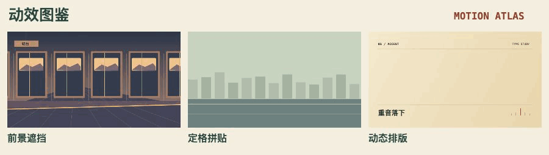

# 动效图鉴 · Motion Atlas

**按用途找动效，看懂它怎么动，再把手法用到自己的片子里。**

[在线打开图鉴并点播 →](https://ian-zy1.github.io/motion-atlas/)

## 怎么用

- **找手法**：用中文描述意图，例如「镜头穿过前景」，或者搜英文术语、按用途筛选。
- **看门道**：共 15 张卡片。先看代表帧，再点播；有关键帧的卡片还可以直接跳到动作节点。
- **换自己的场景**：复制通用模板，把方括号里的主体、场景或文案替换掉。收藏只保存在当前浏览器。

单页 HTML，无需安装。也可以下载 `index.html`，离线打开；跳转到参考原文时才需要联网。

这是动效参考图鉴，不是视频素材包，也不提供剪辑工程或渲染导出。

## 来源与许可

怪想实验室整理。白模代码、字形轮廓与手法参考见 [第三方来源和许可](THIRD-PARTY-NOTICES.md)。第三方部分沿用上游许可；本项目原创部分采用 [MIT 许可](LICENSE)。
